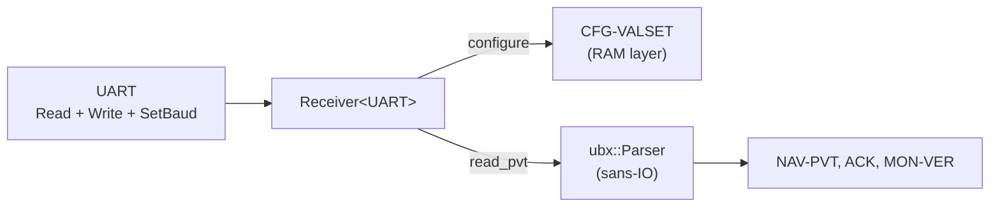

# sam-m10q

Driver for the u-blox SAM-M10Q GNSS receiver on a UART. UBX protocol only: NMEA is switched off. `no_std`, no allocation, no panics outside tests, on the `embedded-io-async` 0.7 and `embedded-hal-async` 1.0 traits (optional `defmt`). Works with any executor or none.



- Sans-IO core: `ubx::Parser` (streaming, resynchronises on garbage, counts bad checksums, ignored and oversize frames), `ubx::write_frame`, `config::ValSet`.
- Async driver: `Receiver<UART>` with `configure` and `read_pvt`.
- Decoded: UBX-ACK-ACK, ACK-NAK, MON-VER (software and hardware strings) and NAV-PVT (all 92 bytes).

## Quick start

```ignore
let mut gnss = sam_m10q::Receiver::new(uart); // uart: Read + Write + sam_m10q::SetBaud
let version = gnss.configure(&sam_m10q::Config::default(), &mut delay).await?;
loop {
    let pvt = gnss.read_pvt().await?;
    if pvt.is_3d_fix_ok() { /* lat/lon in 1e-7 degree, height mm, velocities mm/s */ }
}
```

The UART type implements `SetBaud` (`fn set_baud(&mut self, u32)`) because the driver cannot change the UART's baud rate itself.

## Docs

| Page | In one line |
|---|---|
| [docs/device.md](docs/device.md) | UBX framing, CFG-VALSET, the `configure` flow, `read_pvt`, defaults and timing |
| [hil/README.md](hil/README.md) | On-board test programs and how to run them |

## Status

- Host tests: `cargo test` covers checksum and VALSET golden bytes, NAV-PVT golden decode, a parser property test with random chunking and garbage, a fake receiver at 9600 / 38400 / 115200, and the `NoReceiver`, `Rejected`, `NoAck` and `BaudSwitchFailed` errors. A drop of `configure` at every poll is tested too. `cargo clippy --all-targets -- -D warnings` and `cargo build --target thumbv8m.main-none-eabihf` are the other checks.
- On the board (MARV V2, UART1): `sam_m10q_smoke` configures the receiver and reads NAV-PVT for 10 s; see [hil](hil/README.md).
- Not established: the module's default baud as delivered, whether NMEA is on at start, the worst poll time of `Receiver` on the board.

## Used by

The MARV V2 flight-controller firmware ([MARV-FC](https://github.com/Lmx154/MARV-FC)) pins this crate.

## MARV project

| Repository | Role |
|---|---|
| [MARV-FC](https://github.com/Lmx154/MARV-FC) | Flight-controller firmware for the MARV V2 board (RP2350B) |
| [MARV-GCS](https://github.com/Lmx154/MARV-GCS) | Ground station (`marv-gcs`) and command line (`marv-cli`) |
| [MARV-sim](https://github.com/Lmx154/MARV-sim) | Simulator that runs the firmware's flight code |
| Sensors | [icm45686](https://github.com/Lmx154/icm45686-rs) · [lsm6dsk320x](https://github.com/Lmx154/lsm6dsk320x-rs) · [bmp581](https://github.com/Lmx154/bmp581-rs) · [bmm350](https://github.com/Lmx154/bmm350-rs) · **sam-m10q** · [adc-battery](https://github.com/Lmx154/adc-battery) |
| Board I/O | [pio-sdmmc](https://github.com/Lmx154/pio-sdmmc-rs) · [qmi-psram](https://github.com/Lmx154/qmi-psram-rs) · [ws2812c](https://github.com/Lmx154/ws2812c-rs) · [usb-cdc](https://github.com/Lmx154/usb-cdc) · [pio-uart](https://github.com/Lmx154/pio-uart) |
| Motors and links | [dshot](https://github.com/Lmx154/dshot-rs) · [esc-passthrough](https://github.com/Lmx154/esc-passthrough) · [rc-port](https://github.com/Lmx154/rc-port) · [crsf-codec](https://github.com/Lmx154/crsf-codec) · [mavlink-device](https://github.com/Lmx154/mavlink-device) · [marv-dialect](https://github.com/Lmx154/marv-dialect) |
| Other drivers | [lc76g](https://github.com/Lmx154/lc76g-rs) (Quectel LC76G GNSS) |

## License

MIT, see `LICENSE`.
