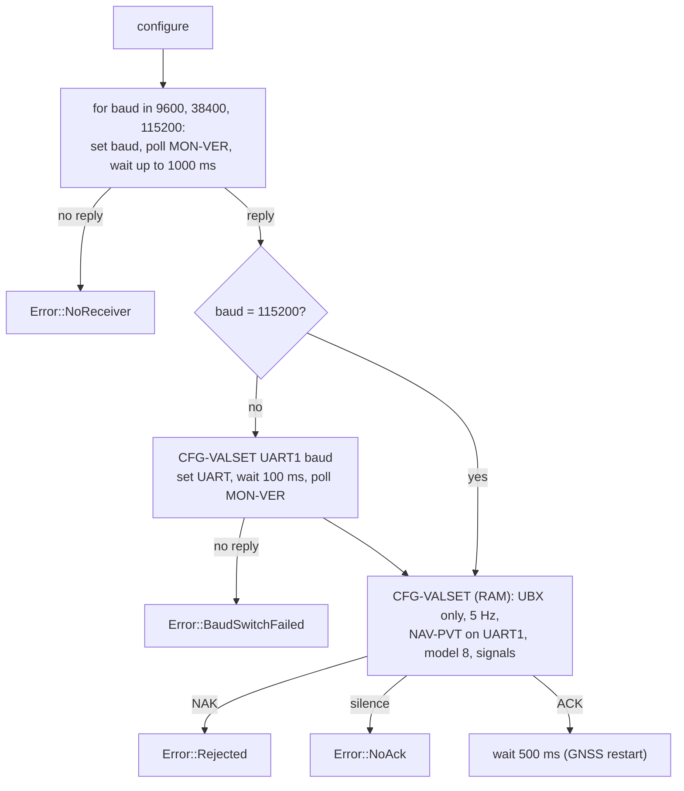

# SAM-M10Q protocol and driver flow

Part of [sam-m10q](../README.md)

UBX framing, the CFG-VALSET configuration, the `configure` sequence and the timing rules the driver follows. Sources are the u-blox documents for the M10 family (SAM-M10Q data sheet, integration manual, M10 SPG 5.10 interface description "IM") and ArduPilot's `AP_GPS_UBLOX_CFG_List.h`.

## UBX frame

`B5 62 | class | id | len U2 LE | payload | CK_A CK_B`, 8-bit Fletcher over class to payload end. MON-VER poll: `B5 62 0A 04 00 00 0E 34`.

## CFG-VALSET (06 8A)

Version 0, layers 0x01 (RAM), 2 reserved bytes, then key U4 LE and value. The value size comes from key bits 28..30 (1 and 2 one byte, 3 two bytes, 4 four bytes, 5 eight bytes); at most 64 pairs (`config::MAX_PAIRS`). The driver writes the RAM layer only; nothing is saved.

| Setting | Key |
|---|---|
| UART1 baud rate | 0x40520001 |
| UART1 input UBX / NMEA | 0x10730001 / 0x10730002 |
| UART1 output UBX / NMEA | 0x10740001 / 0x10740002 |
| Measurement period / navigation rate | 0x30210001 / 0x30210002 |
| NAV-PVT on UART1 | 0x20910007 |
| Dynamic model | 0x20110021 |
| Static hold threshold | 0x20250038 |
| Signals | GPS, Galileo, BeiDou, QZSS, GLONASS enables and their L1/E1/B1/B1C bands in `config` |

## Configure defaults

| Item | Default |
|---|---|
| Baud candidates | 9600, 38400, 115200 |
| Target baud | 115200 |
| Reply timeout | 1000 ms |
| Baud settle | 100 ms |
| Signal settle | 500 ms |
| Measurement period | 200 ms (5 Hz); 200, 500 or 1000 ms only for this constellation set (data sheet tables 1 and 2); `config::MEAS_RATES_MS` lists 100, 200, 500, 1000 |
| Navigation rate | 1 |
| Dynamic model | 8 (airborne, 4 g) |
| Static hold threshold | 0 (off) |

Every default is a named constant in `src/config.rs` that cites its source. ArduPilot's `config_M10` also sets CFG-SIGNAL-QZSS_L1S_ENA = 1; `Config` does not.

## Timing rules

- ACK-ACK / ACK-NAK (05 01 / 05 00) answer within 1 s (IM 3.9). A baud-rate change takes about 100 ms (IM p22).
- A CFG-SIGNAL change restarts the GNSS; wait for the acknowledgement plus 0.5 s (integration manual).
- The baud-rate CFG-VALSET is sent without requiring its acknowledgement (the rate changes under it); the following MON-VER reply is the success check.

## read_pvt

`read_pvt` returns `Error::NotConfigured` until `configure` has completed (the flag is cleared before its first await and set after its last), and returns on the checksum byte of the NAV-PVT frame. NAV-PVT is decoded in full (92 bytes): latitude and longitude in 1e-7 degree, height in mm, velocities in mm/s; `is_3d_fix_ok()` tells whether a position is usable.

## Code

| Path | Contents |
|---|---|
| `src/lib.rs` | `Receiver`, `Error`, `SetBaud` |
| `src/ubx.rs` | `Parser`, `write_frame`, checksum |
| `src/msg.rs` | decoded messages (ACK, MON-VER, NAV-PVT) |
| `src/config.rs` | `Config`, `ValSet`, keys, defaults |

## Related

[hil](../hil/README.md) · [README](../README.md)
